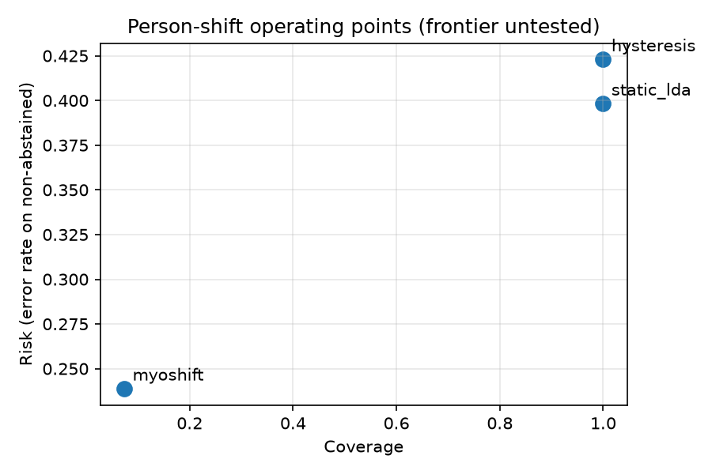

# MyoShift

RoboteX Labs' public-data engineering demonstration of reproducible sEMG command-event evaluation under participant, session and proxy electrode shifts. The reusable capability is an audited data-to-report pipeline: verified inputs, leakage-aware splits, record resets, measured rest exposure and participant uncertainty. This corrected negative study provides no evidence of client delivery, paid firm past performance, adoption or clinical benefit.



Each annotated point is one fixed operating point, not a measured frontier. Four healthy seated participants, heavy abstention and short rest exposure limit interpretation; zero counts cannot establish safety.

Person-shift selective window recall is lower than static LDA: 0.073 [0.031, 0.137] versus 0.512 [0.381, 0.751]. Trial-event recall is a separate, coarse detection metric, not physiological event timing. The available runs counted 92 false command events in total across the repeated method evaluations. Short laboratory rest exposure and a zero-count bootstrap interval cannot establish safety equivalence. Decoder novelty remains withdrawn. Threshold-swept risk-coverage and matched-recall comparisons are untested. Person coverage stop rule fired: False. Hysteresis interval-overlap novelty stop fired: True. This withdrawal stop is not an equivalence test. The few-shot baseline is unavailable under the frozen rest-only calibration prefix. No general benchmark novelty or clinical usefulness is established by this repair.

## Run the demonstration

```sh
python3 -m venv .venv
source .venv/bin/activate
pip install -e ".[dev]"
bash scripts/download_pilot.sh
python scripts/run_benchmark.py
python scripts/generate_documents.py --check
python -m pytest -o addopts= -m 'not network' --cov=myoshift --cov-fail-under=90
```

The single benchmark command regenerates JSON, traces, figures and current documents headlessly from downloaded public data. The network test needs internet access and an empty destination; cached acceptance is recorded separately. Python 3.11 on macOS arm64 is locally exercised; Python 3.12 is configured in CI and awaits a hosted receipt. No other platform is validated.

CLI example: `myoshift verify-scorers`; library entry: `myoshift.eval.benchmark.run_full_benchmark(data_root, output_dir)`.

## Inspect the evidence

[Compact verification receipt](docs/milestones/PUBLICATION_FIX_REPORT_3_2026-10-01.md), [full results and limitations](RESULTS.md), [negative-result report](docs/negative-result-report.md), [technical report](docs/technical-report.md). Frozen protocol bytes are preserved; the chronology of a pre-result freeze remains unverified.

Related work: [EMGBench](https://arxiv.org/abs/2410.23625), [generic neuromotor interface](https://doi.org/10.1038/s41586-025-09255-w). Data: [GRABMyoFlow](https://physionet.org/content/grabmyo-flow/1.0.0/). No omission or superiority over these resources is claimed.

## Licence and citation

Code: [Apache-2.0](LICENSE). Documentation and derived results: [CC BY 4.0](https://creativecommons.org/licenses/by/4.0/). See [NOTICE](NOTICE) for exhaustive scopes and upstream credit, and [CITATION.cff](CITATION.cff).
